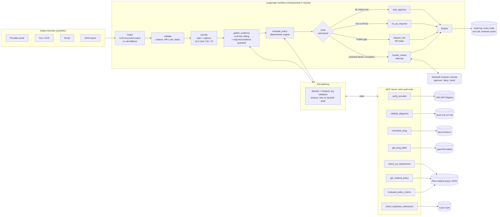

# Agentic Prior Authorization Intake: LangGraph + MCP

An AI agent that does the first pass on **prior authorization (PA) requests** at a health plan. It reads messy submissions (portal forms, OCR'd faxes, emails, EHR exports), extracts structured fields, checks the provider, diagnoses and drug against **live public healthcare APIs**, evaluates the plan's medical policy, and then either **auto-approves**, **pends with a request for information**, closes the request as **no PA required**, or **pauses for a licensed human reviewer**. It never denies a request on its own.

**Stack:** Python · LangGraph (state graph, SQLite checkpointing, `interrupt()` for human review) · MCP (Model Context Protocol server for the tools) · LLM tool calling + structured outputs (OpenAI or Anthropic, with a rule-based fallback) · Pydantic · REST APIs (CMS NPPES, NLM ICD-10-CM, NLM RxNorm, openFDA) · SQLite audit log · Streamlit reviewer console · pytest

## The problem

Prior authorization is one of the most manual parts of US healthcare administration. Most requests still come in by fax, portal or phone, and nurses re-key them, look up the provider, check codes and read the policy before they can decide. Under the **CMS Interoperability & Prior Authorization Final Rule (CMS-0057-F)**, Medicare Advantage, Medicaid, CHIP and ACA marketplace plans have had to decide **expedited requests within 72 hours and standard requests within 7 calendar days** since **January 1, 2026**. Getting the routine requests out of the queue automatically, and putting clean, evidence-backed packets in front of reviewers for the rest, is how plans meet those deadlines.

## What it does



| Step | What happens | AI vs deterministic |
|---|---|---|
| **intake** | Free text → `ExtractedRequest` (member, NPI, CPT/HCPCS or drug, ICD-10 codes, urgency, clinical facts) | LLM structured output; falls back to regex rules if the LLM errors or no key is set |
| **validate** | Required fields, NPI check digit (CMS Luhn), date sanity, extraction confidence | Deterministic |
| **classify** | Request type (pharmacy, imaging, surgical, DME, sleep study, therapy) + urgency; starts the 72-hour / 7-day SLA clock | LLM (safety rule: if either the LLM or the extractor says *expedited*, it's expedited) |
| **gather_evidence** | The LLM chooses which approved tools to call. A guardrail then runs any **required** evidence call the LLM skipped | LLM tool calling + guardrail |
| **evaluate_policy** | Policy criteria (conservative-therapy weeks, step therapy, BMI, AHI, specialist prescriber, benefit exclusions) → met / not met / missing / waived | **Deterministic engine.** The LLM never decides coverage |
| **route** | AUTO_APPROVE · NO_PA_REQUIRED · PEND_INFO · HUMAN_REVIEW, with a plain-English reason for each | Deterministic rules |
| **human_review** | Graph **pauses** (`interrupt`) and the case appears in the Streamlit queue (expedited first). A reviewer approves, denies or pends; a denial requires a written rationale | Human |

### Tools (served by the MCP server `prior-auth-tools`)

| Tool | Backed by |
|---|---|
| `verify_provider` | **CMS NPPES NPI Registry API**: checksum, active status, taxonomy/specialty |
| `validate_diagnosis` | **NLM Clinical Tables ICD-10-CM API** |
| `normalize_drug` | **NLM RxNav / RxNorm API**: brand, generic or misspelling → ingredient RXCUI |
| `get_drug_label` | **openFDA drug label API**: FDA-labeled indications, on-label check per diagnosis |
| `check_pa_requirement`, `get_medical_policy`, `evaluate_policy_criteria` | Plan medical policy (`data/policy/medical_policy.json`) |
| `check_duplicate_submission` | Case store: same member + item within 30 days |

Each API client tries the **live API first** and falls back to a dated snapshot in `data/reference/` if the API is unreachable. A circuit breaker stops retrying an API that is down, and the result records whether each fact came from `live` or `cache`.

## Responsible-AI controls

- **No automated denials.** The agent's authority is limited to approve, pend for information, or no-PA-required. Every potential denial goes to a clinician (as CMS and many states require).
- **Tool allowlist + argument schemas.** The tool gateway refuses any tool not on the approved list and any call whose arguments fail Pydantic validation. Both are logged (`tool_rejected`). Unit tests prove an LLM request for `delete_member_records` and a malformed `verify_provider` call never execute.
- **Required-evidence guardrail.** If the LLM forgets to verify the provider or a diagnosis, the guardrail runs the call anyway (`origin: guardrail` in the log).
- **Structured outputs everywhere.** LLM output must validate against Pydantic schemas. If it doesn't, the step falls back to the deterministic path, and the fallback is logged.
- **Resilience.** Timeouts, retries with exponential backoff, a circuit breaker and snapshot fallback. A chaos mode (`PA_FAULT_RATE`) injects transient tool failures to prove they're recovered.
- **Minimum necessary data.** Member name and DOB are never sent to the LLM in the tool-calling step. Member IDs are stored hashed in the audit log.
- **Full audit trail.** Every node (with duration), tool call (args, attempts, latency, data source), LLM fallback and reviewer decision is written to SQLite and exported as JSONL.

## Data

| Data | Source | Real or synthetic |
|---|---|---|
| Requesting providers (47 NPIs, 12 specialties, Philadelphia) | CMS NPPES NPI Registry API, pulled 2026-10-29 | **Real public data** |
| ICD-10-CM codes (32, including 3 that the API rejects: `G35`, `M17.99`, `E11.99`) | NLM Clinical Tables API | **Real** |
| Drugs (22 names → RxCUIs, plus a misspelling) | NLM RxNorm API | **Real** |
| FDA label indications (10 biologic / GLP-1 / specialty labels) | openFDA drug label API | **Real** |
| Medical policy (19 services/drugs) | Written for this project and modeled on typical published payer criteria | Illustrative, fictional plan |
| PA requests (240 development + 120 holdout) | `scripts/generate_synthetic_requests.py` | **Synthetic** (real requests contain PHI) |

The synthetic generator writes 12 scenario types with ground-truth labels: clean, no PA required, missing documentation, criteria not met, medical-director review, invalid NPI, invalid ICD-10, specialty mismatch, off-label / benefit exclusion, unrecognized drug, duplicate, and expedited. The **holdout set** adds wording and an EHR-export layout that the rule-based extractor was never developed against, to measure what happens when extraction breaks.

## Results (rule-based mode, `LLM_PROVIDER=none`)

| Metric | Development set (240) | Holdout: unseen formats (120) |
|---|---|---|
| Routing accuracy vs ground truth | **100%** | 66.7% |
| **Unsafe auto-approvals** (approved when policy didn't support it) | **0** | **0** |
| Requests resolved without a human (approve / no-PA / RFI) | 68.3% | 56.7% |
| Field extraction accuracy | 100% (*same templates the rules were built on*) | 75.0% |
| Request-type / urgency accuracy | 100% / 100% | 81.7% / 95.0% |
| Agent latency per request, p50 / p95 | 83 ms / 176 ms | 69 ms / 100 ms |
| Tool calls through MCP | 1,604 | 599 |
| Injected transient tool failures (5% chaos run) | 83 injected, **83 recovered by retry**, 0 unrecovered | not run |
| Requests with an SLA due time stamped (72 h / 7 d) | 100% | 100% |

How to read these numbers:

- **The development-set 100% is not a model score.** The rule-based extractor was written against those templates, so it mainly shows that the policy engine, routing, MCP tools and human-review loop all work end to end.
- **The holdout set is the real test.** When the rules can't read a field, the workflow **fails safe**: the missed approvals were pended or escalated, and nothing was approved that the policy didn't support. Two holdout "duplicates" were auto-approved because the first copy of each was unreadable (it went to a reviewer as an unrecognized item), so the two copies were never linked. They are reported separately (`auto_approved_duplicates`).
- **The most important holdout miss is urgency.** Requests marked only "STAT ... time-sensitive" were read as standard, which puts them on a 7-day clock instead of 72 hours. This is the clearest case for LLM extraction (or a broader urgency vocabulary).
- **The evaluation also caught a real bug.** A pediatric allergist's NUCC taxonomy reads "Pediatric Allergy/Immunology", which did not match the policy's "Allergy & Immunology", so the agent sent a valid Dupixent request to a human. The alias was added to the policy.
- **LLM mode is implemented and unit-tested but not benchmarked here.** No API key was available when these numbers were produced. The holdout gap is exactly what LLM extraction is meant to close. Run `LLM_PROVIDER=openai python scripts/run_batch.py --requests data/synthetic/holdout_pa_requests.jsonl --truth data/synthetic/holdout_ground_truth.jsonl --tag _holdout_llm` to measure it.

Full outputs are in `outputs/`: `metrics*.json`, `decisions*.csv` (one row per request, with route, reasons and SLA due time) and `execution_log*.jsonl` (every node and tool call).

## Run it

```bash
python -m venv .venv && source .venv/bin/activate
pip install -r requirements.txt
cp .env.example .env                       # optional: set LLM_PROVIDER + API key

python scripts/run_batch.py                # 240 requests: live APIs w/ snapshot fallback, tools over MCP
PA_FAULT_RATE=0.05 python scripts/run_batch.py   # chaos run: 5% of first tool attempts fail
python scripts/run_batch.py --requests data/synthetic/holdout_pa_requests.jsonl \
       --truth data/synthetic/holdout_ground_truth.jsonl --tag _holdout

streamlit run app/streamlit_app.py         # reviewer queue, overview, audit trail, evaluation
pytest -q                                  # 10 tests

python scripts/refresh_reference_data.py   # re-pull all reference data from the live APIs
python -m pa_agent.mcp_server              # (with PYTHONPATH=src) run the MCP server for any MCP client
```

LLM mode: `pip install langchain-openai` (or `langchain-anthropic`), then set `LLM_PROVIDER=openai` and `OPENAI_API_KEY` in `.env`.

## Project layout

```
src/pa_agent/
  graph.py          LangGraph workflow (nodes, routing rules, interrupt for human review)
  mcp_server.py     MCP server exposing the 8 approved tools
  gateway.py        tool gateway: allowlist, schema validation, retries, fault injection, logging
  tools.py          tool implementations + Pydantic argument schemas
  clients.py        NPI / ICD-10 / RxNorm / openFDA clients with live -> snapshot fallback
  policy_engine.py  deterministic medical-policy evaluation
  extraction.py     LLM structured extraction + rule-based fallback, classifier
  schemas.py        Pydantic models for every structured output
  audit.py          SQLite case store + execution log (hashed member IDs)
  runner.py         batch processing, resume-after-review
app/streamlit_app.py      reviewer console
scripts/                  data generator, batch runner + evaluator, reference-data refresh
data/reference/           real API snapshots   data/policy/  plan policy   data/synthetic/  requests + ground truth
tests/                    policy engine, extraction, gateway guardrails, HITL resume, chaos retry
```

## Limitations

The requests are synthetic and the plan policy is illustrative, so the results show workflow behavior, not clinical accuracy. The on-label check maps ICD-10 prefixes to label wording and is a screening flag, not a clinical determination. A production system would add FHIR Da Vinci PAS/CRD interfaces, authentication on the MCP server, and a reviewed policy library.
